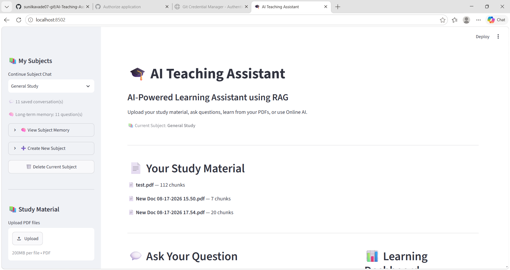
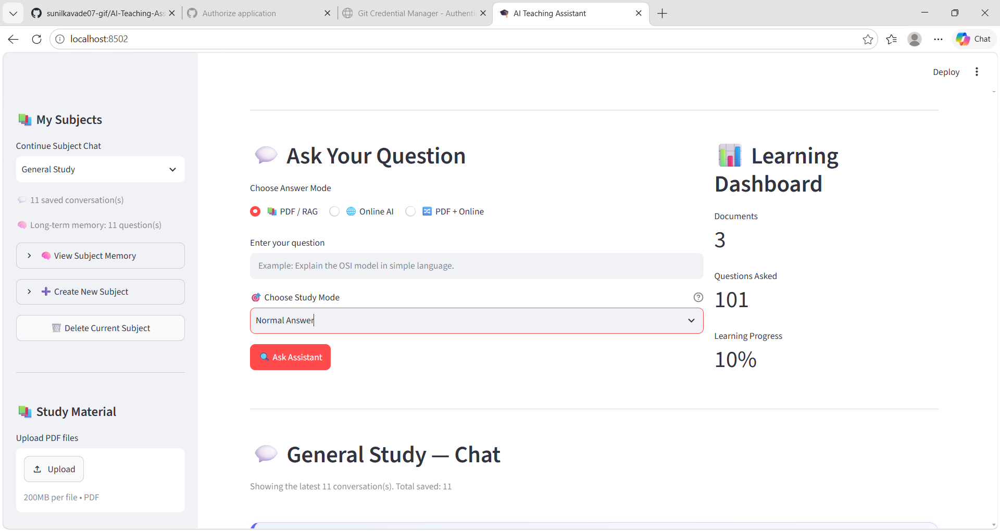
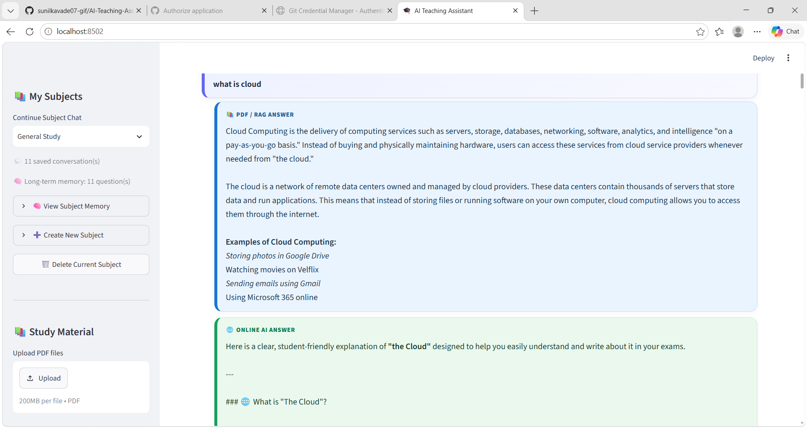
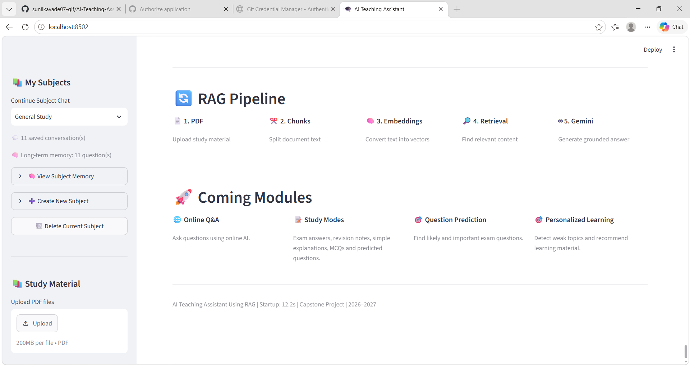

# 🎓 AI Teaching Assistant

An AI-powered teaching assistant designed to help students interact with educational materials, ask questions, and access relevant learning information.

<p align="center">
  <b>AI-Powered Learning | Document Processing | Intelligent Question Answering</b>
</p>

---

## 📌 Project Overview

The **AI Teaching Assistant** is a Python-based application that aims to make learning more interactive and accessible through artificial intelligence.

The project includes modules for document processing, content retrieval, question handling, and AI-generated responses. It is designed to help students explore educational content and find relevant information more efficiently.

## ✨ Features

- 🤖 **AI-Powered Question Answering:** Generate answers to educational questions using the configured AI services.
- 📄 **Document Processing:** Process educational documents for use within the application.
- 🔍 **Information Retrieval:** Retrieve relevant information from available learning materials.
- 🧠 **Question Assistance:** Support question-based interactions with educational content.
- 📚 **Subject Organization:** Manage subject-related information using project data files.
- 🧩 **Modular Architecture:** Organize functionality into separate Python modules.
- 🖥️ **Application Interface:** Provide an interface for interacting with the assistant, as implemented in the project.

*Note: Features depend on the application's actual implementation and configuration.*

## 🛠️ Technology Stack

The project uses Python and supporting libraries for its application logic.

- **Programming Language:** Python
- **AI Integration:** Configured AI/LLM services
- **Document Processing:** Python-based document processing modules
- **Information Retrieval:** Retrieval components for educational content
- **Dependency Management:** pip and `requirements.txt`
- **Version Control:** Git and GitHub

Update this section with the exact AI models, frameworks, databases, and libraries used in your implementation.

## 📂 Project Structure

```text
AI-Teaching-Assistant/
│
├── app.py
├── main.py
├── online.py
├── cloud_auth.py
├── generator.py
├── chunker.py
├── retriever.py
├── pdf_processor.py
├── question_predictor.py
├── storage.py
├── requirements.txt
├── .env.example
├── .gitignore
├── README.md
│
├── subjects.json
├── subject_memory.json
│
├── 01-dashboard.png
├── 02-question-interface.png
├── 03-ai-answer.png
├── 04-rag-pipeline.png
│
└── Additional application modules and test files
```

## ⚙️ Installation and Setup

Follow these steps to set up the project on your local machine.

### 1. Prerequisites

Install the following:

- Python version compatible with the project dependencies
- Git
- A code editor, such as Visual Studio Code
- Any API credentials required by the application

### 2. Clone the Repository

Open a terminal and run:

```bash
git clone https://github.com/rameshwarkawade/AI-Teaching-Assistant.git
```

Navigate to the project directory:

```bash
cd AI-Teaching-Assistant
```

### 3. Create a Virtual Environment

Create an isolated Python environment:

```bash
python -m venv venv
```

Activate it on Windows:

```bash
venv\Scripts\activate
```

On macOS or Linux:

```bash
source venv/bin/activate
```

### 4. Install Dependencies

Install the required Python packages:

```bash
pip install -r requirements.txt
```

### 5. Configure Environment Variables

Check `.env.example` for the environment variables required by the application.

If the project uses a `.env` file, create one locally and add the required configuration values.

For example:

```env
# Add the variable names required by your application.
# Replace placeholder values with your own credentials locally.
```

**Security:** Never commit real API keys, passwords, access tokens, or other sensitive credentials to GitHub.

### 6. Run the Application

Check the project configuration and the instructions in the source code to determine the correct entry point.

For example, if `app.py` is the configured application entry point, run:

```bash
python app.py
```

If the project uses another entry point, follow its actual startup instructions.

## 🖥️ Application Screenshots

The repository includes image files that may be used to document the application's interface and workflow.

Add screenshots below after confirming the images accurately represent the application.

### Dashboard



### Question Interface



### AI-Generated Answer



### RAG Pipeline



## 🔄 How It Works

The application is organized into modules that support its educational question-answering workflow.

A typical retrieval-based question-answering workflow consists of:

1. **Input:** A student submits a question or selects educational material.
2. **Processing:** The application processes the input.
3. **Retrieval:** Relevant information is retrieved from available learning materials, if supported by the implementation.
4. **Generation:** The configured AI service generates a response using the available context.
5. **Output:** The response is presented to the student through the application interface.

The exact workflow depends on the project's implementation and configuration.

## 🎯 Project Objectives

- Explore practical applications of artificial intelligence in education.
- Make educational information easier to access.
- Support interactive question-answering workflows.
- Organize document processing and information retrieval.
- Develop practical experience with Python and AI application development.

## 🚀 Future Improvements

Potential improvements include:

- Support for additional educational document formats.
- Improved retrieval accuracy and response relevance.
- More detailed source references for generated answers.
- Enhanced user interface and accessibility.
- Student progress tracking, if appropriate for the application.
- Automated tests and deployment support.
- Better error handling and configuration management.

These are possible future enhancements, not claims about currently implemented functionality.

## 🔒 Security and Responsible Use

- Keep API credentials private.
- Do not upload personal or confidential documents without appropriate authorization.
- Verify AI-generated information before relying on it for academic work.
- Follow the licenses of the source code, libraries, models, and other resources used in the project.

## 📚 Learning Outcomes

This project can provide practical experience with:

- Python application development
- Modular software architecture
- AI-powered application workflows
- Document processing
- Information retrieval
- Dependency management
- Git and GitHub

List only the skills and techniques you have personally used or can explain confidently.

## 👨‍💻 Author

**Rameshwar Kawade**

GitHub: [@rameshwarkawade](https://github.com/rameshwarkawade)

Project Repository: [AI-Teaching-Assistant](https://github.com/rameshwarkawade/AI-Teaching-Assistant)

## 🙏 Acknowledgements

This project is based on an existing codebase. Please retain the original author's attribution, acknowledge relevant contributors, and comply with the repository's license and other applicable terms.


---

⭐ If you find this project useful, consider starring the repository.
